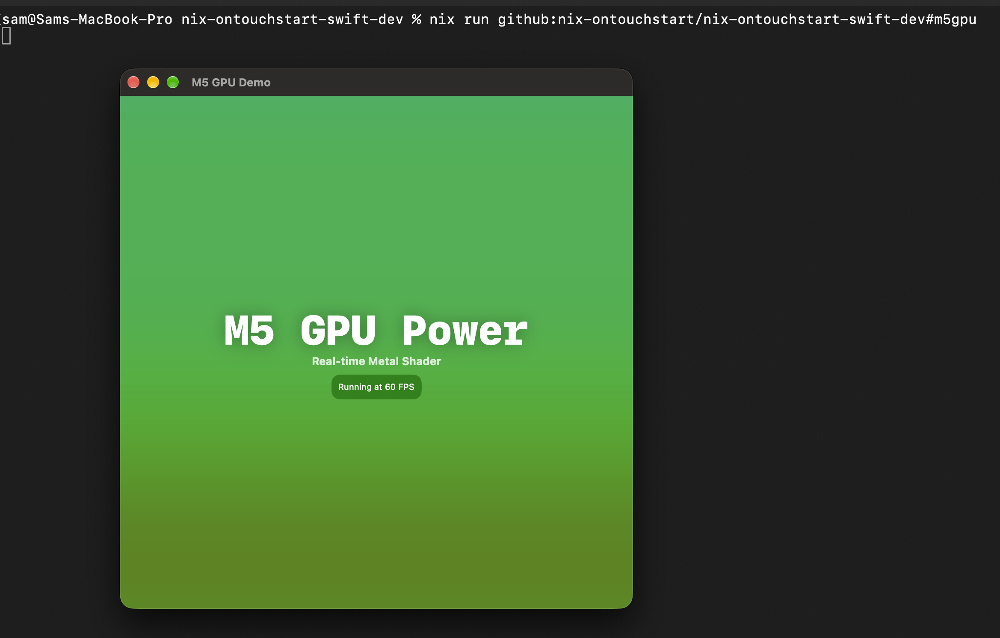
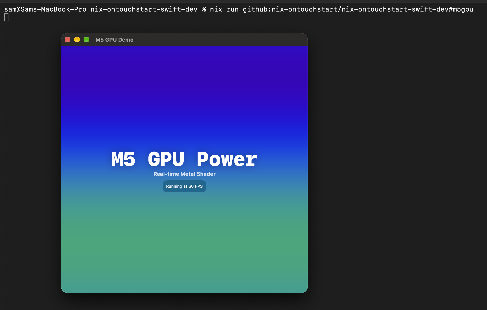
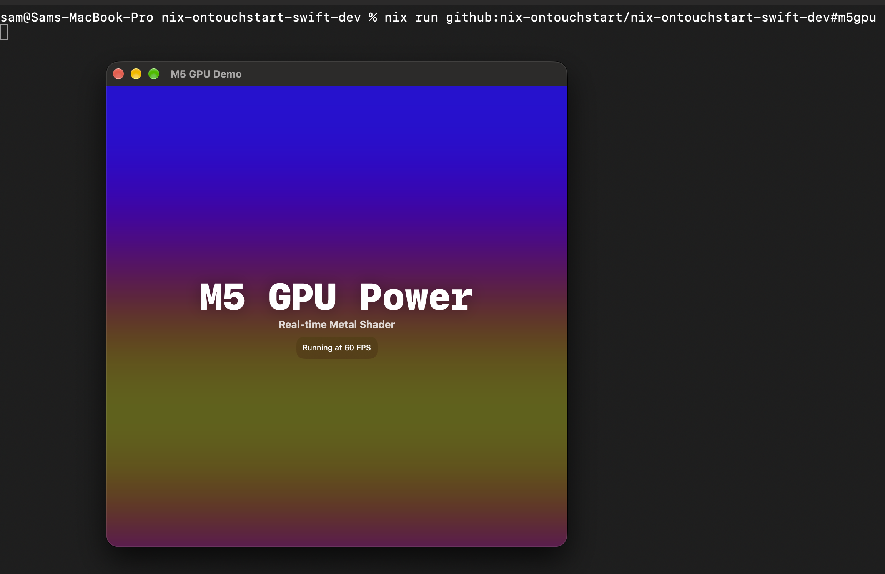
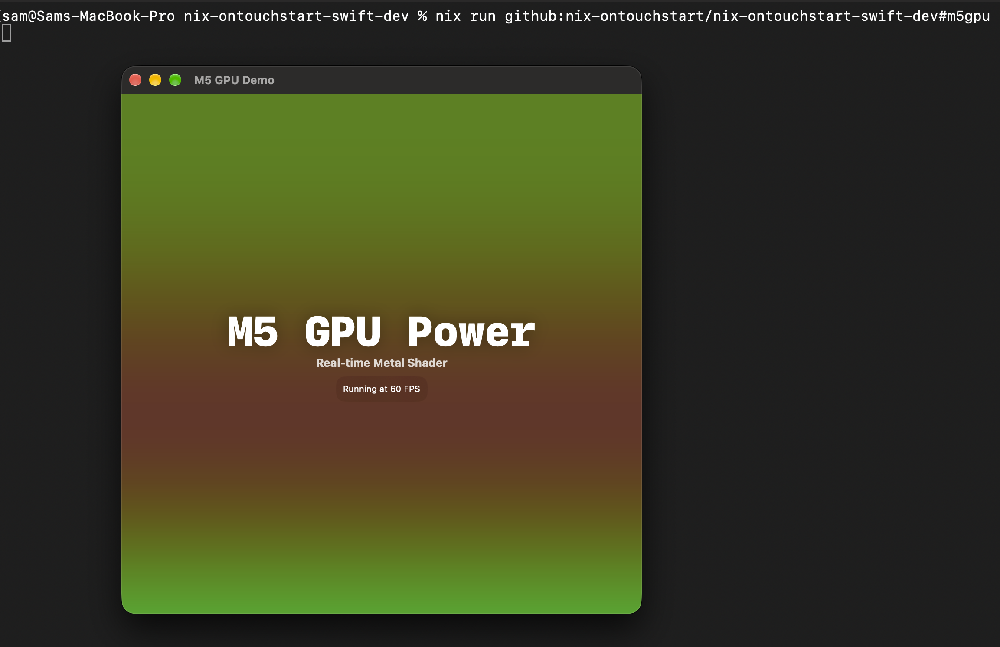

# github:nix-ontouchstart/nix-ontouchstart-swift-dev

```
nix run github:nix-ontouchstart/nix-ontouchstart-swift-dev
```


```
nix run github:nix-ontouchstart/nix-ontouchstart-swift-dev#hello
```


```
nix run github:nix-ontouchstart/nix-ontouchstart-swift-dev#fancy
```


```
nix run github:nix-ontouchstart/nix-ontouchstart-swift-dev#m5gpu
```









