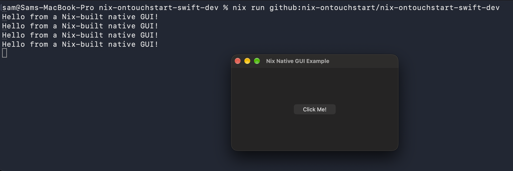
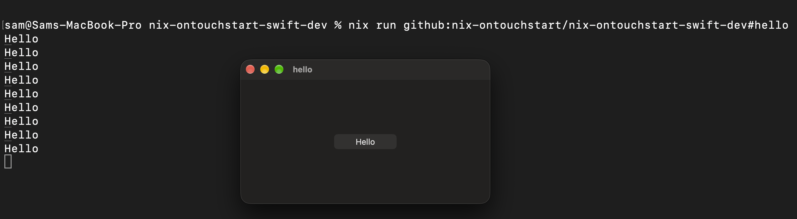

# github:nix-ontouchstart/nix-ontouchstart-swift-dev

```
nix run github:nix-ontouchstart/nix-ontouchstart-swift-dev
```



```
nix run github:nix-ontouchstart/nix-ontouchstart-swift-dev#hello
```



